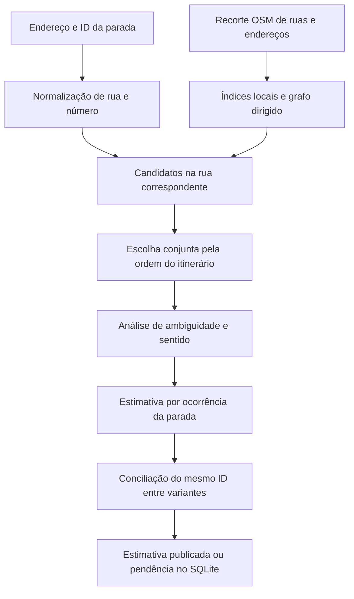

# Importações externas e localização aproximada das paradas

## Escopo e rastreabilidade

O MBM consulta o SQLite para montar a interface de passageiros e o catálogo. A ferramenta
`/explorar/` mantém sua consulta exploratória ao Overpass. Importação de cadastro,
geocodificação e simulação são etapas distintas. Nenhuma coordenada produzida pelo
algoritmo abaixo equivale a uma vistoria do ponto ou à validação da operadora.

O manifesto `fonts/sources.json` identifica as fontes do cadastro. As respostas são
preservadas em `fonts/raw/`, junto com URL, data de acesso, SHA-256, tipo de conteúdo,
`Last-Modified`, quando fornecido, e o corpo de requisições de consulta POST. O SHA-256
permite conferir se a resposta usada na importação foi modificada. `Last-Modified` não
é a data de manutenção de todo o sistema. A tabela `SourceDocument` guarda os metadados,
a situação e o texto dos documentos; PDFs ficam no disco e têm o texto extraído por
`pdftotext`. HTML é convertido em texto sem executar scripts.

`fonts/collected.json` guarda a normalização de linhas, variantes, paradas e sequência.
`Stop`, `Route` e `RouteStop` são as tabelas correspondentes. Um ID de parada pode
aparecer repetidamente no mesmo percurso; a chave da sequência é linha/posição.
Registros de provedores diferentes não são fundidos apenas por endereço semelhante.

## Inventário das fontes utilizadas

| Fonte e endereço | Dados efetivamente aproveitados | Limites |
| --- | --- | --- |
| [Cittamobi/Suzantur Mauá](https://linhas.cittamobi.com.br/linhas/estado/sao-paulo/maua/suzantur-maua) | Todas as páginas do catálogo descobertas na paginação; páginas de variantes; ID, endereço e ordem das paradas; informações de horários embutidas nas páginas | Variantes, testes e sentidos permanecem separados. O HTML coletado não fornece coordenadas numéricas. Não pressupomos que todos os serviços listados estejam vigentes. |
| [PDF da variante 088 Zaira](https://linhas.cittamobi.com.br/maps/transporte_publico-Maua-Suzantur-Maua-088-ZAIRA-169f6fbfd86b.pdf) | Documento do itinerário, endereços ordenados e horários; preservação e extração textual | Documento de exemplo com data declarada de 04/04/2026; não representa todas as linhas. |
| [Suzantur Mauá](https://suzanturmaua.com.br/linhas/) | Catálogo oficial e páginas individuais das linhas; documentos e horários para conferência | Não inferimos uma sequência de pontos de embarque a partir de uma mera lista de ruas. |
| [Prefeitura: mudanças de fevereiro de 2026](https://www.maua.sp.gov.br/Noticias/Ler/173) | Linhas 71, 75 e 76 e seus itinerários por ruas em cada sentido, vigência indicada em 28/02/2026 | Não contém coordenadas de todas as paradas. O anúncio de uma alteração não é um inventário completo da rede. |
| [EMTU: portal](https://www.emtu.sp.gov.br/emtu/itinerarios-e-tarifas.fss) e [consulta por logradouro](https://www.emtu.sp.gov.br/Sistemas/linha/resultado.htm?chviatrans=151066&pag=buscarua.htm) | Seis registros do resultado e links para seus itinerários individuais | Consulta parcial por logradouro; não equivale a todas as linhas intermunicipais de Mauá. |
| [PlanMob, anexo à Lei 5.250/2017](https://sistemas.maua.sp.gov.br/legislaconsulta/atosofic/Leis/5250%20-%20anexo.pdf) | PDF e texto para fundamentação, mapas e diagnóstico histórico | Propostas e projeções não são convertidas em linhas atuais. |
| [Moovit/Suzantur Mauá](https://moovitapp.com/index/pt-br/transporte_p%C3%BAblico-lines-Sao_Paulo-242-3779814) | Página do catálogo como documento de conferência | Não foi importada uma base geográfica completa do Moovit. Contagens da operadora podem abranger municípios vizinhos. |
| [Ônibus Online/Mauá](https://onibus.online/sp/maua/) | Documento de conferência do catálogo | Não gera automaticamente pontos, vínculos ou coordenadas. |
| [Bus2/Mauá](https://bus2.me/sp/maua/) e [painel indicado pela página](https://painel.mobilibus.com/bus2you/home?p=1hl6p) | Páginas de referência; tentativa de consulta pública POST `/public/get-project`, `miniHash=1hl6p` | O endpoint de dados retornou HTTP 500. A falha fica registrada; nenhum dado operacional foi inventado a partir dela. |
| [OpenStreetMap](https://www.openstreetmap.org/copyright), recorte `fonts/osm.json` | 142 registros de paradas/terminais e nove relações de linhas do levantamento de 23/09/2026 | Coordenadas de centros de objetos OSM não são necessariamente uma plataforma. Relações incompletas permanecem fora do planejamento. |
| OSM/Overpass, `fonts/geolocation.overpass` | Ruas, nós, geometria, sentidos, acessos e endereços numerados para geocodificação local | Recorte limitado ao retângulo `(-23.74,-46.54,-23.60,-46.39)`, incluindo áreas vizinhas; não representa uma validação dos limites municipais de cada objeto. |
| [OSRM](https://project-osrm.org/docs/v5.24.0/api/) / `backend/transit/data/route_geometry.json` | Geometrias viárias previamente obtidas para as seis linhas demonstrativas; preservadas como segmentos no SQLite | São percursos calculados para a demonstração, não itinerários oficiais. A etapa de geocodificação não substitui esses percursos por uma reta. |

Além dessas importações, os mosaicos do mapa são carregados do OpenStreetMap pelo
Leaflet, sem constituir um cadastro de paradas. A busca interativa de endereços já
existente usa Nominatim; ela é separada da geocodificação em lote descrita aqui.

### Consulta geográfica e datas

`fonts/download_geolocation.py` consulta primeiro `https://overpass-api.de/api/interpreter`
e, em caso de falha, `https://overpass.kumi.systems/api/interpreter`. Preserva o resultado
em `fonts/geolocation_osm.json` e os metadados em `fonts/geolocation_osm.meta.json`.
A primeira coleta teve HTTP 504 no primeiro servidor e sucesso no segundo.

A coleta de 24/09/2026 recebeu **26.393 objetos**. A resposta declarou a data-base OSM
**15/07/2026 15:22:01 UTC**, anterior ao acesso. Não a apresentamos como uma fotografia
atualizada até setembro. O índice encontrou 2.385 endereços numerados utilizáveis;
objetos sem numeração inteira ou coordenadas suficientes não viram âncoras numéricas.
Os metadados preservam a data real fornecida pelo servidor e o checksum.

O recorte também preserva objetos `addr:interpolation`, mas esta versão do algoritmo
não interpreta suas regras especiais: a interpolação implementada usa pares de
endereços explicitamente numerados, conforme descrito abaixo.

## Algoritmo de geolocalização aproximada

Implementação: `backend/transit/geolocation.py`; execução: `geolocate_stops`.
Versão inicial em uso: **osm-address-directed-v1.1**. Os limiares são heurísticos,
não resultados de uma calibração de precisão com a operadora.



### 1. Normalizar e consultar o endereço

- Mantemos o endereço original, o ID do provedor e a variante de origem.
- Removemos acentos e pontuação para comparar nomes; expandimos abreviações como
  `R.` → `rua`, `Av.` → `avenida`, `Estr.` → `estrada` e `Dr.` → `doutor`.
- Extraímos o número do imóvel. Um intervalo como `4019-4075` usa o ponto médio
  numérico, 4047, como hipótese; isso não indica onde a placa do ponto está instalada.
- Procuramos `name`, `alt_name` e `short_name` nas vias. Quando não há correspondência
  exata, admitimos similaridade textual mínima de 0,90 e diferença mínima de 0,05
  para o segundo nome candidato. Caso contrário, a rua fica pendente.
- A cidade, quando explicitada no endereço e na âncora OSM, deve concordar. Não é
  possível comprovar a cidade de uma âncora sem esse atributo apenas pelo texto.

A consulta ocorre no recorte local; **não são feitas milhares de chamadas ao Nominatim**.
A [política do serviço público Nominatim](https://operations.osmfoundation.org/policies/nominatim/)
limita requisições, exige identificação/cache e restringe geocodificação em lote.
O recorte permite repetir o algoritmo offline e preservar exatamente sua entrada.

### 2. Construir candidatos de posição

A prioridade é o endereço OSM com a mesma rua e número. Para polígonos de edifícios,
usamos a média dos vértices disponíveis como aproximação de referência — não uma
entrada georreferenciada do imóvel.

Sem número exato, procuramos números inferior e superior na mesma rua. Interpolamos
linearmente apenas se as âncoras estiverem a até **500 m** entre si e sua diferença
numérica não exceder **1.000**. Não extrapolamos além dos números conhecidos.
A distribuição dos números e a paridade das calçadas não são comprovadas por esse
procedimento; por isso o resultado continua estimado.

Projetamos cada referência em segmentos da rua correspondente, aceitando distância
máxima de **100 m**. Em coordenadas métricas locais, para um ponto `P` e segmento `A→B`:

```text
t = limitar(((P−A) · (B−A)) / |B−A|², 0, 1)
Q = A + t(B−A)
```

A conversão local usa 111.320 m/grau de latitude e o cosseno da latitude de referência
−23,67° para longitude. É uma aproximação planar para esta região, não uma projeção
global. Retemos até quatro projeções mais próximas das referências numéricas.

Sem âncoras numéricas utilizáveis, geramos cinco hipóteses distribuídas pelo
comprimento acumulado dos segmentos da rua. Elas são **candidatos de baixa confiança**;
a posição central de uma rua não é publicada automaticamente como ponto de ônibus.

### 3. Considerar o sentido do itinerário

Cada candidato contém um segmento OSM e um sentido permitido. O grafo usa os nós
compartilhados da malha, não liga vias apenas porque parecem próximas na imagem.
`oneway=-1` inverte a orientação; `oneway:bus` e `oneway:psv` podem alterar a regra
geral. Proibições explícitas para ônibus e acessos privados sem exceção são filtrados.
Vias com regras condicionais de sentido/acesso reconhecidas ficam fora desta versão,
pois não avaliamos um calendário operacional.

Entre candidatos de paradas consecutivas, calculamos distância na malha dirigida com
**A\*** e heurística euclidiana. A busca é limitada a **8 km** entre nós. Descontamos/
acrescentamos as frações do segmento antes e depois da projeção; deslocamentos para
trás em uma via de mão única não são aceitos como movimento direto.

A programação dinâmica escolhe a sequência com menor custo:

```text
Fₜ(c) = custo_local(c) + mínimoₚ [ Fₜ₋₁(p) + distância_dirigida(p,c) / 150 ]
custo_local(c) = distância_da_referência_à_rua / 30 + penalidade_do_nome
penalidade_do_nome = 1 para correspondência textual aproximada; 0 para exata
```

Esse custo escolhe hipóteses geográficas coerentes; **não estima tempo de viagem**.
Uma parada sem candidatos divide o processamento em blocos. Não pulamos uma parada
sem localização para inventar uma conexão. Se não houver caminho dirigido para um
bloco, ele permanece pendente.

A ordem publicada pelo provedor é a evidência do sentido: não inferimos o sentido
apenas do nome `Centro`, `Bairro` ou de um número crescente de imóveis. A orientação é
medida pela geometria física, inclusive quando duas pistas têm ordens de nós distintas.

### 4. Medir ambiguidade e estimar o lado da rua

Comparamos o custo da sequência escolhida com o de hipóteses alternativas distantes
mais de 40 m ou com diferença angular superior a 45°. Publicamos uma estimativa
somente quando a margem de custo é pelo menos **0,5** e há referência numérica.
Candidatos sem número exigem margem **1,0** e referências numéricas nas duas posições
anteriores e nas duas posteriores do bloco (ao menos uma de cada lado).

Depois, aplicamos um deslocamento de **3 m à direita do sentido selecionado**, uma
hipótese compatível com a circulação usual no Brasil. Esse deslocamento não mede
largura da pista, calçada ou posição de abrigo. Faixas especiais, embarque à esquerda,
ilhas centrais e terminais exigem revisão; não são inferidos com segurança.

Guardamos separadamente o ponto projetado no eixo da rua, a posição deslocada, o
azimute, o ID da via, as âncoras, o método, a margem e o motivo da decisão.

### 5. Conciliar o mesmo ponto entre variantes

A tabela `StopEstimate` guarda uma estimativa por **execução + variante + posição**, relacionada
ao ID da parada. Isso permite auditar ocorrências repetidas e sentidos conflitantes.
Uma posição de ocorrência ainda pendente pode ter coordenadas hipotéticas registradas
para revisão, mas elas não são publicadas no mapa como coordenadas da parada.

Quando há estimativas aceitas para o mesmo ID, comparamos todas elas. Se o maior
desacordo superar **60 m**, ou os sentidos divergirem mais de **90°**, a parada fica
com conflito e sem coordenada publicada. A verificação angular evita conciliar
sentidos opostos apenas porque os pontos ficaram próximos.
Caso contrário, usamos o **medoide**: uma das posições efetivamente calculadas, com
menor soma de distâncias às demais. Evitamos uma média que poderia cair no meio de
uma quadra ou entre pistas. Isso não funde IDs diferentes de paradas.

Os estados são `estimated`, `pending` e `conflict`. `validated` é reservado a uma
validação humana explicitamente registrada; o algoritmo nunca o atribui.

## Persistência, atualização e administração

- `GeolocationRun`: versão, checksum da entrada, data e resumo de cada execução.
- `StopEstimate`: candidato escolhido, coordenadas por ocorrência e evidências.
- `Stop.data.geolocation`: estado da coordenada publicada e referência da execução.
- `fonts/geolocation_runs/run-<id>.json`: relatório completo da execução, inclusive
  pendências, endereços consultados, decisões e metadados do recorte.
- `SourceDocument`: procedência do novo recorte OSM, além das fontes anteriores.

No admin, consulte **Stop estimates** e **Geolocation runs** para auditoria. Os
registros de estimativa são de leitura. Em **Stops**, uma revisão humana pode corrigir
latitude/longitude e registrar `data.geolocation.status = "validated"`, acrescentando
revisor, data e evidência nesse objeto JSON. Apenas alterar uma coordenada não a
transforma automaticamente em validada.

A reimportação do mesmo endereço preserva sua estimativa. Uma mudança de endereço
invalida suas estimativas; uma mudança na ordem das paradas invalida as estimativas
da variante e as posições derivadas afetadas. Depois dessas mudanças, execute o
geolocalizador novamente. Coordenadas OSM importadas diretamente não são substituídas
pela inferência dos endereços Cittamobi.

Na interface, posições estimadas recebem contorno tracejado e o aviso **posição
aproximada**. O catálogo informa pendências e a situação da inferência do sentido.
Ter coordenadas aproximadas não ativa automaticamente planejamento operacional das
linhas reais: tempos, geometrias verificadas e demais dados continuam necessários.

## Executar e reproduzir

Na raiz do MBM, com o ambiente Python ativo:

```bash
workon bus
python backend/manage.py migrate
# Atualizar primeiro o cadastro, caso necessário:
python backend/manage.py import_sources --download
# Baixar ruas e endereços e executar a conversão:
python backend/manage.py geolocate_stops --download
# Repetir offline sobre a mesma entrada:
python backend/manage.py geolocate_stops
# Diagnóstico de uma variante:
python backend/manage.py geolocate_stops --route cittamobi:169f6fbfd86b
```

O modo por variante é estritamente diagnóstico: grava a execução e suas evidências,
mas não altera coordenadas publicadas nem substitui estimativas no catálogo do passageiro.
Somente uma execução completa publica posições e concilia as ocorrências do mesmo ID
em toda a rede. A publicação usa exclusivamente as estimativas dessa execução, sem
reaproveitar resultados históricos, diagnósticos ou execuções malsucedidas.
Reexecuções e reimportações preservam as evidências anteriores no banco; mudanças
de endereço ou sequência invalidam a publicação, não apagam o histórico. O recorte e os relatórios volumosos não são
versionados no Git; preserve `fonts/geolocation_osm.json`, seu `.meta.json` e os
relatórios para reprodução exata. Uma nova coleta pode ter dados diferentes.

## Limitações que exigem revisão

- Falta de números, ruas homônimas, intervalos extensos ou endereços sem bairro.
- Malha incompleta, dados antigos, acesso condicional e sentidos desatualizados.
- O algoritmo não interpreta relações OSM de restrição de conversão, vias com regras
  operacionais especiais nem permissões de embarque por faixa.
- A rota de menor distância entre hipóteses não comprova o trajeto autorizado da linha.
- Lado direito e deslocamento de 3 m são hipóteses geométricas, não levantamento físico.
- Os limiares de confiança não são percentuais de acerto nem intervalos estatísticos.
- A ausência de resultado mantém a parada cadastrada e pendente, sem fabricar latitude
  e longitude para preencher o mapa.

Os testes cobrem normalização e intervalos de números, projeção limitada ao segmento,
sentidos opostos, exceções de mão única, ausência de caminho, endereço inexistente,
interpolação sem extrapolação e preservação/invalidação na reimportação.


## Resultado da execução inicial

Execução auditada `run-2`, algoritmo `osm-address-directed-v1.1`, em 24/09/2026:

| Medida | Resultado |
| --- | ---: |
| Variantes Cittamobi processadas | 164 |
| Endereços distintos consultados no índice local | 1.192 |
| Ocorrências de paradas nos itinerários | 3.735 |
| Ocorrências com estimativa aceita | 272 |
| Ocorrências pendentes | 3.463 |
| IDs de paradas com coordenada aproximada publicada | 30 |
| Registros com coordenadas, incluindo os 142 OSM anteriores | 172 |

Das ocorrências aceitas, quatro usaram número exato, 194 interpolação entre números
e 74 hipóteses na rua apoiadas pela sequência e por referências numeradas vizinhas.
Contagens de ocorrências não são contagens de paradas físicas. Entre as pendências,
575 não tiveram rua identificada sem ambiguidade, 2.626 tiveram endereço/sentido
ambíguo e 262 não tiveram continuidade dirigida dentro dos limites da busca.

Os 1.444 registros Cittamobi restantes continuam sem coordenadas publicadas.
Nenhuma das 30 posições produzidas foi marcada como validada. Os dados e decisões
completos estão em `fonts/geolocation_runs/run-2.json` e nas tabelas de auditoria.
